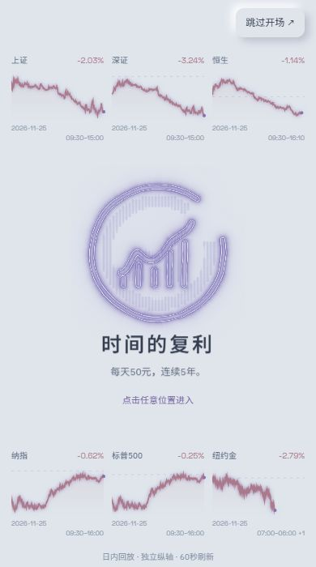
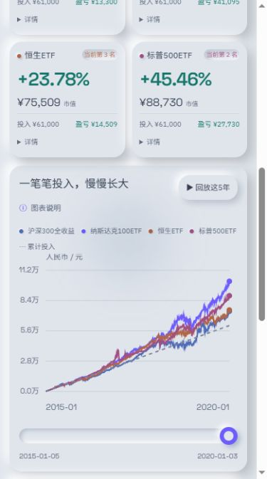

# 时间的复利 · 定投交互实验室

## [打开最新网页 →](https://dashline-l-creator.github.io/dca-investment-lab/)

在线地址固定，电脑和手机均可直接访问，无需下载。


比较每天投入 **50元人民币、持续五年**的历史结果。七种资产中自选四种，观察不同起投日的收益、分布与达标比例。支持中英文、手机/平板/电脑、时间旅行与三维图表。

**当前网页版本：v3.11.0** · [在线打开](https://dashline-l-creator.github.io/dca-investment-lab/) · [上一发布版离线网页](https://github.com/dashline-L-creator/dca-investment-lab/releases/download/v3.10.1/dca-lab-v3.10.1.zip) · [全部历史版本](https://github.com/dashline-L-creator/dca-investment-lab/releases) · [研究口径](docs/研究口径.md) · [开发说明](docs/开发与维护.md)

## 使用

- **在线使用**：点击上面的“打开最新网页”，也可从仓库右侧 About 的网站链接进入。
- **离线使用**：下载离线包，解压后打开 `index.html`。字体、研究数据和图表均已内置。
- **下载整个仓库**：直接打开 [`dist/index.html`](dist/index.html)，无需安装依赖。
- **历史版本**：在 Releases 选择版本，下载 `dca-lab-版本.zip`。历史源码通过同名Git标签查看。

研究部分离线可用。开场六市场行情需要联网，每60秒尝试刷新；失败时保留最近可用行情并标明时间。它与冻结的定投数据分别维护。

 

## 研究范围

| 资产 | 使用标的 | 五年滚动样本数 |
|---|---|---:|
| 沪深300 | 全收益指数 H00300 | 4,088 |
| 黄金 | 华安黄金ETF 518880 | 2,010 |
| 5年期国债 | 国泰上证5年期国债ETF 511010 | 2,092 |
| 纳斯达克100 | 人民币QDII ETF 513100 | 2,060 |
| 恒生 | 华夏恒生ETF 159920 | 2,194 |
| 10年期国债 | 国泰上证10年期国债ETF 511260 | 1,014 |
| 标普500 | 人民币QDII ETF 513500 | 1,896 |

共 **15,354** 个样本。起投截止2021-10-31，最后实际起投日2021-10-29；估值覆盖至2026-10-31。累计收益率为 **期末总市值÷总投入−1**，未年化。分红再投资、允许小数份额、忽略交易费用，拆分和停牌单独处理。

共同区间取所选四种资产起投日交集；各自全部历史保留独立样本。相邻五年样本高度重叠，历史频率不等于未来概率。[完整口径与来源](docs/研究口径.md)

## 目录

```text
src/                 当前一套网页源码、样式和语言配置
assets/              共用字体、品牌Logo
vendor/              离线依赖与原始效果参考
licenses/            第三方字体和效果库授权
data/research/       冻结研究数据、统计基准、CSV导出
data/market/         独立的行情快照
tests/               回归检查与最小真实行情夹具
scripts/             统一构建、检查和发布打包入口
dist/                可直接打开的最新版单文件网页
docs/                研究口径、维护说明、归档记录与预览
```

## 开发

需要 **Python 3.10+、Node.js 20+**。使用标准库，无需安装第三方依赖。

```sh
python scripts/build.py
python scripts/check.py
```

本机PowerShell可使用：

```powershell
& 'F:\anaconda3\python.exe' scripts/check.py
```

统一检查覆盖350组直方图配置、研究统计基准、独立行情纵轴、午休与跨日时间轴、窄屏刻度及开场交互。另附可选的GitHub自动检查模板。[开发与发布流程](docs/开发与维护.md)

## 版本与授权

旧版网页转为Releases附件，历史计算脚本与原始响应另有 [研究与构建资料包](https://github.com/dashline-L-creator/dca-investment-lab/releases/download/v3.10/research-and-build-history-v3.10.zip)。已有提交和标签保留。[归档清单与校验摘要](docs/releases.json)

v3.10.1修复二维点阵因绘图变量作用域错误而中断的问题，增加真实绘图回归检查，并启用公开GitHub Pages访问。[托管与搜索说明](docs/网页托管.md)

第三方许可统一存放于 [`licenses/`](licenses/)，来源见 [第三方资源说明](docs/第三方资源.md)。本次未新增项目整体的开源许可证。

当前版增加顶部 Summer Ghost 音乐控件（网易云公开外链，需联网，未包含音频文件）。开场等待点击进入，并在点击时启动音乐；浏览器拦截时点击播放，外链不可用时可跳转网易云。移除动态背景开关，背景默认常驻，保留系统减少动态偏好。v3.11.0 动效改动一并纳入。
